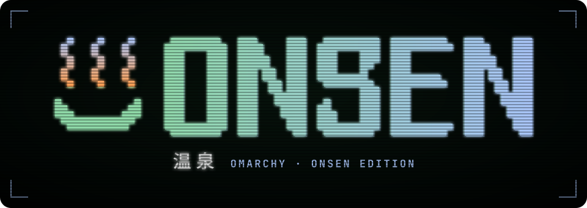

  

**Omarchy Quattro, drawn hot and quiet.** Onsen is a personal edition of [Omarchy](https://omarchy.org), DHH's beautiful, fun & agentic Linux distribution. It keeps upstream's desktop and adds a hardware-key workflow, a two-monitor desk, and a home for a fleet of coding agents. One command keeps it all rebased onto upstream.

> **Inspiration for your own agent, not a template to clone.** Onsen is one person's machine, written down in full. It isn't meant to be cloned and edited line by line. Point your own agent at this repository, tell it which ideas you like, and let it build them into your setup in its own way. The [In depth](#in-depth) section is written for exactly that reader.

**Pairs with [onsen-matrix](https://github.com/lkingland/onsen-matrix),** the edition's screensaver. It renders the Matrix's rain as a 3D space you walk through: columns of the Lotus Sutra fall near and far across every display, and it ends the instant you touch anything. On Onsen it is the Screensaver entry in the Super+Esc menu under System. The stock ASCII screensaver is the Builtin Screensaver entry.

**Built on [smartsocket](https://github.com/lkingland/smartsocket)** for the YubiKey. Every SSH login and every Git and Jujutsu signature here comes from the card, and smartsocket is what makes that painless. It sits in front of the standard gpg-agent and ssh-agent sockets and sends each request to wherever a usable key actually is: the card plugged into this machine, or one forwarded over SSH from the machine you are sitting at. PIN prompts come back to your own screen, so signing works the same at the desk or three hops away.

## At a glance

**One command keeps it current**
- `onsen update` rebases the edition onto upstream Quattro, then builds, signs and installs it.
- It stops before it overwrites anything you changed by hand.
- A rebuilt machine comes back as itself, with the same tailnet node, SSH host keys, Syncthing device and Bluetooth pairings.
- `onsen diff` and `onsen identity` show exactly where a machine stands.

**Every key lives on a YubiKey**
- SSH, Git and Jujutsu authenticate and sign from the card.
- SSH in works over the tailnet only, with keys only and no root.
- The PIN prompt follows you to whichever machine you are sitting at.

**A desktop built for two big screens**
- Super + number reaches the focused monitor's own workspaces.
- The bar rests hidden on the bottom edge and never moves a window.
- HJKL moves focus everywhere, and the trackpad is tuned.
- Bluetooth keyboards and trackpads reconnect on their own.
- A JetKVM shows up as just another monitor.

**A terminal that gets out of the way**
- The Onsen tmux: a two-line status bar, quick session jumps, one key to a blocked agent.
- Bash with atuin history. Tokens come from Bitwarden when a command runs and are never stored.
- Shift+Enter reaches an agent as a newline through foot and tmux.

**Neovim, kept honest**
- Omarchy's LazyVim config byte for byte, with our plugins beside it.
- Plugin versions are pinned, and an update shows up as drift.

**Ready for an agent fleet**
- Claude Code is the default agent, and voxtype does dictation.
- oomd is masked, so one out-of-memory kill never takes every pane with it.
- A local embedder runs on the CPU and leaves the GPU idle.

## Getting started

To run the edition as it is:

1. Install stock Omarchy Quattro.
2. Install `pcsclite`, `ccid`, `jujutsu` and `go`, and enable `pcscd.socket`.
3. Clone this repo, `go install ./cmd/onsen`, and run `onsen update`.
4. Reboot when it offers, then run `onsen update` once more. The second run finds no drift.

The full bootstrap, including the YubiKey prerequisites, is under [In depth](#in-depth).

---

## In depth

This section is written for agents and for anyone who wants the whole story. The fork is Omarchy Quattro with the changes below written into the files it ships. Hypr loads `default/hypr/` from this tree, then the `~/.config/hypr/` overrides, which stay as Quattro ships them apart from the monitor scale, mode, and placement direction. The other config under `config/` ships through `/etc/skel` and is copied onto the home. Each item below is one commit on top of Quattro, in order.

### `onsen update`

`onsen` is this fork's own command, a Go program (`cmd/onsen`, its parts under `internal/`). Install it from the checkout with `go install ./cmd/onsen`; it lands in `~/go/bin`, which the session PATH carries. From then on `onsen update` keeps it current: when a rebase changes its source, it builds itself, checks that the build starts, installs it, and finishes the run as the new build. A build that fails leaves the installed one in place, and the run carries on and reports it.

The other verbs:
- `onsen` alone will show the machine's status (for now it prints where to go instead).
- `onsen update --check` runs only the drift check below and reports the fork's state, changing nothing.
- `onsen diff` shows, as diffs, every shipped file whose live copy differs from the edition's, the files on `default/onsen/drift-ignore` included, and names the local files below an ignored path. That is the drift the check does not stop on, which an app rewrote and a rebuild would lose, so a change worth keeping can be carried into the fork by hand (`--ignored` for those alone, `--names` without the diffs).
- `onsen identity` shows the machine's identity files beside their copies.

**What stops a run before it changes anything.** `onsen update` stops first if any config in `~/.config`, `~/.gnupg`, or `~/.ssh` that the edition ships:
- has been edited by hand (an edit that matches the checkout's copy is a change committed and not yet shipped, so committing drift clears it);
- has a new file beside it in a directory the edition ships into (`default/onsen/drift-ignore` lists the paths apps write themselves);
- or sits below a directory that is a link (it never writes through one).

It also stops if a package is explicitly installed that neither Quattro's install lists nor `default/onsen/packages` declares. Stock `omarchy` and `omarchy-settings` are allowed, since the same run replaces them.

**What a run does, in order.**
1. Rebases these commits onto upstream Quattro (they are pushed, so jj would call them immutable; the rebase overrides that) and stops on a conflict.
2. Pulls upstream's PKGBUILDs and shows, as patches, what changed under `pkgbuilds/omarchy-nvim` since the last run. That is the Neovim config this edition carries a copy of in `config/nvim`, so an idea there is copied over by hand or left, never merged.
3. Builds `omarchy-dev` and `omarchy-settings-dev` from this tree with upstream's PKGBUILDs (`~/src/kingland.io/omarchy-pkgs`), signs them with the YubiKey, and publishes them to the local `[onsen]` repository at `/var/lib/omarchy-onsen`. `[onsen]` is kept the first repository, since `[omarchy]` carries packages with the same names.
4. Removes the packages the edition takes away and runs the stock `omarchy update` unattended.
5. Installs the declared packages that are missing: repository ones with pacman, `aur:` ones with yay. A `local:` one is built by hand from its own checkout, so it is only named when missing.
6. Keeps the machine's identity files in step with their copies under `~/state/identity`: the tailnet node key, the SSH host keys, the Syncthing device, the Bluetooth pairings, and the touch-to-sudo enrolment. Live wins and the copy is refreshed from it; on a fresh install a copy fills what is missing, so a rebuilt machine comes back as itself.
7. Copies the config files the new `/etc/skel` ships into `~/.config`, `~/.gnupg`, and `~/.ssh`, removing any it stopped shipping that are unchanged.
8. Enables the services `default/onsen/services` declares, after the copy so a unit the config ships is in place first. One already enabled but not running is started, since a user unit whose start condition failed at login stays dead until then.
9. Offers a reboot last, if the update needs one.

**How it behaves.**
- A file it replaces that matched neither the last run nor the edition (on a machine's first run, any file it replaces) is kept under `~/.local/state/omarchy/onsen-replaced/`.
- A declared package that will not install or a service that will not start does not stop the run: it finishes, names the problem, and exits non-zero.
- Ctrl-C lets the running program finish its own cleanup and stops before the next.
- Only one update runs at a time.
- sudo is asked for once, up front, and kept fresh for the whole run, so a prompt never lands mid-step and times out; once the wheel rule is in, it never asks.
- It never runs `omarchy-reinstall-configs`, because `/etc/skel` also marks every migration done.

### Bringing a machine onto the edition

To bring a fresh install of stock Quattro onto the edition:
1. Install `pcsclite`, `ccid`, `jujutsu`, and `go`; enable `pcscd.socket`.
2. Copy `bin/omarchy-hw-platform` from the checkout into `~/.local/bin`. Stock 4.0.4 ships none, and the channel switch asks it for the platform before the fork's package provides it.
3. Build and enable smartsocket from its own repo (`make install enable`), which provides `pinentry-smart`.
4. Import the signing key's public half (`curl -s https://github.com/lkingland.gpg | gpg --import`; the card has no key URL).
5. Clone this repo colocated as `~/src/kingland.io/onsen` (`jj git clone --colocate`, then add the `upstream` remote), and upstream's `omarchy-pkgs` beside it.
6. In the checkout, `go install ./cmd/onsen` and run `~/go/bin/onsen update`. The PATH line that finds `~/go/bin` ships with that first run and takes effect at the next login.
7. Accept the reboot it offers and run it once more; the second run should find no drift.

A machine being rebuilt first copies its `~/state` (and the other home folders) back from cumulus, so that `onsen update` restores its identity before it enables tailscale and Syncthing. A new machine has nothing to restore, and that run captures its identity.

### System

- **oomd.** Masked, because the agent fleet lives in `app.slice` and one oomd kill there ends every pane. Migration `1791858700`.
- **Sudo.** Wheel needs no password for sudo, and sudo keeps `SSH_AUTH_SOCK`. File: `etc/sudoers.d/50-onsen-agent-sudo`. Migration `1791858701` retires the hand-made `ssh-nopasswd` once this file is in place.
- **DNS.** Cloudflare over TLS (opportunistic), Quad9 as the fallback. File: `etc/systemd/resolved.conf.d/50-onsen-dns.conf`.
- **Podman and Sunshine.** The rootless Podman API socket and Sunshine run as user services, declared in `default/onsen/services`. Sunshine's streaming ports open on `tailscale0` only, like SSH; its credentials live in `~/state`. Migration `1791864400`.
- **Ollama.** The hamr-memory embedder runs on the CPU: `etc/systemd/system/ollama.service.d/cpu-embedder.conf` hides the GPU from the unit, because on ROCm the loaded model holds the card at 100% and about 90 W while idle. `ollama.service` is a declared service.
- **Bluetooth input.** Trusted, paired keyboards and trackpads are paged at login and for the rest of the session by `omarchy-bluetooth-reconnect`, a user unit in `config/systemd/user` enabled as a declared service, since bluez retries only audio profiles. Audio devices are left alone. The TP-Link UB500 dongle is kept out of USB autosuspend (`etc/modprobe.d/bluetooth.conf`), which otherwise dropped the Magic Trackpad's link every half minute. The trackpad's link is also kept out of sniff mode (`etc/udev/rules.d/70-onsen-bluetooth-link-policy.rules` runs `omarchy-bluetooth-link-policy` as the HID device appears), because on this dongle a link in sniff mode carries no input until the host wakes it, while bluez still reports it connected. Migration `1792891069` retires the hand-made autosuspend files and sets the policy on a trackpad already connected. Two earlier fixes for the same symptom were misdiagnoses and are gone: disabling enhanced retransmission (the HID channels never used it) and a udev rule forcing the controller connectable (the kernel pages for trusted devices in its accept list by itself, and the rule hung udev at boot).
- **Agent and dictation.** `config/omarchy/defaults/agent` is claude and `defaults/dictation` is voxtype (stock ships superwhisper), the files Omarchy's setup writes, so a fresh install starts with both set.

### Keys

- **Config reset.** `omarchy-reinstall-configs` replays a copy of `/etc/skel` with `~/.ssh` and `~/.gnupg` removed. Those trees are `onsen update`'s to keep, with a record of what it wrote; the replay has none and would clobber.
- **SSH out.** `~/.ssh/config` ships from `etc/skel/.ssh/config`, and `onsen update` keeps it current as it does `~/.config`. GitHub and gitea pin `IdentityAgent` to smartsocket's socket at the standard gpg-agent path, so a session that arrived with a forwarded agent still offers the card key and not the first key of the agent it brought. `Host *` is last, so the tighter stratus keepalives win. `~/.ssh/config.d/*.conf` is included first and never managed.
- **GnuPG.** `pinentry-smart` forwards the PIN to nimbus when that socket is up, and otherwise uses `PINENTRY_SMART_FALLBACK` (`/usr/bin/pinentry`, Arch's chooser, which picks the themed `pinentry-gnome3` on this desktop; set by the gpg-agent-local drop-in `config/systemd/user/gpg-agent-local.service.d/10-pinentry-fallback.conf`, which ships with `~/.config`). scdaemon uses pcscd and disables PIV so the PIN stays cached; the PIN cache is a day. The confs ship in `/etc/skel/.gnupg`, and `onsen update` manages `~/.gnupg` and `~/.ssh` exactly as it manages `~/.config`.
- **pcscd.** The wheel rule for pcscd is package-owned at `etc/polkit-1/rules.d/99-pcscd-wheel.rules`. `pcsclite` and `ccid` are declared packages and `pcscd.socket` a declared service; smartsocket (`pinentry-smart`) is built from its own repo.
- **Git and Jujutsu.** Both sign with OpenPGP subkey `7DB461E762F282F9` on the YubiKey, under the same name and email. Git's `defaultBranch` is `main`. Jujutsu keeps git-style diffs through delta, and runs difftastic as `jj ds` and `jj dd`. Files: `config/git/config`, `config/jj/config.toml`.
- **SSH in.** Keys only, no root, and only over the tailnet. `etc/ssh/sshd_config.d/50-onsen.conf` turns off passwords and keeps `StreamLocalBindUnlink yes`, so Nimbus can forward its gpg-agent socket again after a dropped session. Migration `1791830300` enables sshd and lets 22/tcp and mosh (60000-61000/udp, declared in `default/onsen/packages`) in on `tailscale0` only; stock `omarchy-setup-security-sshd` would open 22 on every interface.

### Hyprland

Keys, input, and gestures sit in the user override files stock provides, `config/hypr/bindings.lua` and `input.lua`, so `default/hypr` stays upstream's.

- **Workspaces and monitors.** Each monitor has workspaces 1-10 of its own, as upstream ships it (`default/hypr/monitor-workspaces.lua`), so Super + number is a workspace on the focused monitor. Super + Ctrl + number focuses monitor N (stock opens the bar's Nth panel; the letter binds for the panels stay).
- **Keys.** HJKL focuses and Shift+HJKL moves the window. Togglesplit is Ctrl+J and the keybindings menu is Shift+Ctrl+K. Q is the previous workspace on the focused monitor and E the next, like upstream's Super + Tab, and W still closes. The workspace-layout cycle, including its floating mode, has no key: L is focus-right. Ctrl+K stays Herdr and Ctrl+L the lock. Compose is Right Alt and key repeat is 40/200.
- **Trackpad.** Natural scroll, two-finger click, scroll factor 0.4, drag-lock in libinput's timeout mode, and tap-and-drag. A trackpad swipe keeps going past the end workspaces.
- **Borders and gaps.** Outer gap is 0. One visible tiled window, and a workspace that is a single group, draws no border.
- **Display.** The desk is a 42" 4K at scale 1.25, and GDK scale stays 2.
- Files: `default/hypr/bindings/tiling.lua`, `default/hypr/bindings/utilities.lua`, `default/hypr/input.lua`, `default/hypr/looknfeel.lua`, `config/hypr/monitors.lua`.

**The bar.** It sits on the bottom edge and overlays, so it never reserves a strip and showing or hiding it never moves tiled windows.
- Each bar shows its own monitor's workspaces, numbered 1-10. That is upstream's widget now; the fork patched it until upstream gave every monitor its own workspaces.
- It starts hidden (`bar-off`, created once by migration `1791797200`), and resting the pointer on the bottom edge brings it back until the pointer leaves it. A compositor timer in `config/hypr/looknfeel.lua` polls the pointer, since Hyprland raises no event for pointer motion; a bar shown by hand is left alone.
- Its edge, overlay, and background are applied once by migration `1792042330`: the edition ships `config/omarchy/shell.json`, but Omarchy's first login writes one before the edition's copy can seed it.
- Super+Shift+Space shows or hides it, and upstream keeps that choice across login. When it is shown it may cover tmux.
- Files: `config/omarchy/shell.json`, `shell/plugins/bar/Bar.qml` (the `overlay` property).

**JetKVM.** The KVM's screen on the second DisplayPort output is a 1080p monitor at scale 1, placed to the left like any later output and matched by description (`config/hypr/monitors.lua`). Its absolute pointer is narrowed to that screen's share of the layout by a libinput calibration matrix (`etc/udev/rules.d/71-onsen-jetkvm-pointer.rules`), since Hyprland binds only tablets and touchscreens to an output. On its keyboard left Alt is Super (`config/hypr/input.lua`), because a Mac client keeps Command for itself.

**Look.** A 5 px outer gap (`config/hypr/looknfeel.lua`), because the LG TVs' edges do not land exactly on the panel's and a flush window loses its border there. A lone window keeps its border, since on two desks the active border is what says which monitor has focus. The inner gap is stock.

### Branding

The screensaver banner spells the machine's owner, not Omarchy. It is `logo.txt`: the settings package installs that over `/etc/skel/.config/omarchy/branding/screensaver.txt` after it copies `config/`, so the copy under `config/omarchy/branding/` is the same text, kept for the drift check, which reads the checkout's `config/`.

### Screensaver

The Onsen Matrix screensaver ([onsen-matrix](https://github.com/lkingland/onsen-matrix), its own repo and package) is the Screensaver entry in the Super+Esc menu under System. The stock ASCII screensaver is a separate entry, Builtin Screensaver. Matrix takes every display it is given, and any key or pointer movement ends it. It is pinned to the LG TVs by make and model (`--outputs 'desc:LG Electronics'`), so the JetKVM's virtual display stays out whichever connector it lands on: a 60 Hz display in the set would pace every window at 60. If `onsen-matrix` is not installed, both fall back to the stock launcher. Idle starts it too, through `omarchy-launch-screensaver` with no arguments; `force` remains the stock ASCII screensaver. File: `config/omarchy/extensions/omarchy-menu.jsonc` and `bin/omarchy-launch-screensaver`.

### Web apps

SoundCloud has no desktop client, so it is a web app like stock's X and YouTube: `applications/SoundCloud.desktop` opens it in the browser's app mode (its own window and icon; playback reaches the media widget and keys over MPRIS), with the icon under `applications/icons/`, which the settings package installs into the hicolor theme.

### Tmux

Quattro's prefix, splits, history, and truecolor stay. Added:
- OSC 8 hyperlinks, the Onsen two-line status bar on the bottom, and stable window names.
- Session jumps on `f` / `F` / `s`, and `prefix+l` back to the last session.
- `prefix+Tab` next window (`prefix+Shift+Tab` previous), and saving window order on move.
- Shift+Enter delivered as Alt+Enter so Grok can take a newline.
- `prefix+C-k` kills the session, and `prefix+a` jumps to a blocked agent.
- Vim `HJKL` pane swap.

Files: `config/tmux/tmux.conf`, `sessions-menu`, `sessions-ordered`. `session-order.example` is the pin-list template; the live `session-order` stays on the machine. TPM, tmux-sensible, and vim-tmux-navigator are named in the config; migration `1791972926` clones TPM and installs them once, and the navigator takes `C-l`.

### Terminals

Foot: Shift+Return sends Alt+Return (ESC CR), which tmux hands to Grok as a newline. File: `config/foot/foot.ini`.

### Env

- `~/.local/bin` and `~/go/bin` are on the PATH for the whole session: `config/uwsm/default` for the session itself (uwsm exports the environment it computes over environment.d's), `config/environment.d/path.conf` for the user services that start before it.
- `CLAUDE_CONFIG_DIR` points Claude Code at `~/state/claude`, so its config and `.claude.json` live with the other runtime data.
- Files: `config/environment.d/path.conf`, `config/environment.d/claude.conf`.

### Shell

Bash, as stock. The edition's config is `config/bash/rc`, sourced from `~/.bashrc` (migration `1791972923` adds the line once; the shipped `.bashrc` stays stock), and `~/.config/bash/rc.d/*` is sourced last so a theme can add its colors. It carries:
- the aliases and functions: git, eza, systemd, the clipboard, media, a directory stack on `c` and `o`, and `poweroff`, `reboot`, and `shutdown` that ask for the hostname first;
- atuin as the history, through `bash-preexec`;
- the Bitwarden, Jira, and Linode wrappers in `config/bash/tools`. None holds a secret; tokens are read from Bitwarden when a command runs.

`c`, `cx`, `h`, `ga`, and `gd` replace Omarchy's. `config/atuin` is atuin's settings; its history lives in `~/state`.

### Neovim

`config/nvim` is Omarchy's Neovim config, the LazyVim starter plus the overlay in `omarchy-pkgs/pkgbuilds/omarchy-nvim`, byte for byte, with the operator's setup added beside it, so an upstream change there is a copy here and not a merge.
- The additions are the plugin specs under `lua/plugins`, `plugin/after/onsen-options.lua` and `onsen-keymaps.lua` (Neovim runs `plugin/` after `init.lua`; the keymaps wait for VeryLazy so they land after LazyVim's), and the Go extra in `lazyvim.json`.
- The clipboard is Omarchy's `remote_clipboard`; format on save is on, as LazyVim ships it.
- The Onsen colorscheme, the lualine pills, and the markdown heading colours ride the palette commit.
- It ships through `/etc/skel` like the rest, so a hand edit stops `onsen update` until it is in the fork. `lazy-lock.json` is managed: a plugin update shows as drift, and committing it pins the versions.
- `lua/plugins/theme.lua` links to the current Omarchy theme's `neovim.lua`, as the stock starter does.
- Stock `omarchy-nvim` owns the same paths, so `default/onsen/packages` removes it (and declares `neovim`, which it brought), and `onsen update` first deletes any starter file left unchanged in `~/.config/nvim` that the edition does not ship.
- `EDITOR` stays Quattro's launcher, which opens nvim.

---

## The Omarchy Manual

The manual lives in [`manual/`](manual/), which is its authoritative source.

- [Welcome to Omarchy!](manual/01-welcome-to-omarchy.md)

**The Basics**

- [Getting Started](manual/02-getting-started.md)
- [Coming From Mac or Windows](manual/03-coming-from-mac-or-windows.md)
- [Navigation](manual/04-navigation.md)
- [The top bar](manual/05-the-top-bar.md)
- [Themes](manual/06-themes.md)
- [Hotkeys](manual/07-hotkeys.md)
- [Unified Clipboard & History](manual/08-unified-clipboard-history.md)
- [Reminders](manual/09-reminders.md)
- [Notices](manual/10-notices.md)
- [Text Extraction & Dictation](manual/11-text-extraction-dictation.md)
- [Screenshots & Recording](manual/12-screenshots-recording.md)
- [Toggles, idle & screensaver](manual/13-toggles-idle-screensaver.md)
- [Omarchy CLI](manual/14-omarchy-cli.md)

**The Applications**

- [Terminal](manual/15-terminal.md)
- [Neovim](manual/16-neovim.md)
- [AI](manual/17-ai.md)
- [Development Tools](manual/18-development-tools.md)
- [Shell Tools](manual/19-shell-tools.md)
- [Shell Functions](manual/20-shell-functions.md)
- [TUIs](manual/21-tuis.md)
- [GUIs](manual/22-guis.md)
- [Browsers](manual/23-browsers.md)
- [Commercial apps/services](manual/24-commercial-apps-services.md)
- [Web Apps](manual/25-web-apps.md)
- [Gaming](manual/26-gaming.md)
- [Filling out PDFs](manual/27-filling-out-pdfs.md)
- [Windows VM](manual/28-windows-vm.md)
- [Other Packages](manual/29-other-packages.md)

**Configuration**

- [Updates](manual/30-updates.md)
- [Dotfiles](manual/31-dotfiles.md)
- [Shell plugins](manual/32-shell-plugins.md)
- [Monitors](manual/33-monitors.md)
- [Keyboard, Mouse, Trackpad](manual/34-keyboard-mouse-trackpad.md)
- [Networking](manual/35-networking.md)
- [System sleep](manual/36-system-sleep.md)
- [Hardware authentication](manual/37-hardware-authentication.md)
- [Fonts](manual/38-fonts.md)
- [Backgrounds](manual/39-backgrounds.md)
- [Prompt](manual/40-prompt.md)
- [Branding](manual/41-branding.md)
- [Common tweaks](manual/42-common-tweaks.md)
- [Making your own theme](manual/43-making-your-own-theme.md)

**The Rest**

- [Mac support](manual/44-mac-support.md)
- [Troubleshooting](manual/45-troubleshooting.md)
- [FAQ](manual/46-faq.md)
- [System snapshots](manual/47-system-snapshots.md)
- [Security](manual/48-security.md)
- [Omarchy on...](manual/49-omarchy-on.md)
- [Dual Boot Install](manual/50-dual-boot-install.md)
- [Unattended Installs](manual/51-unattended-installs.md)

## License

Omarchy is released under the [MIT License](https://opensource.org/licenses/MIT).
